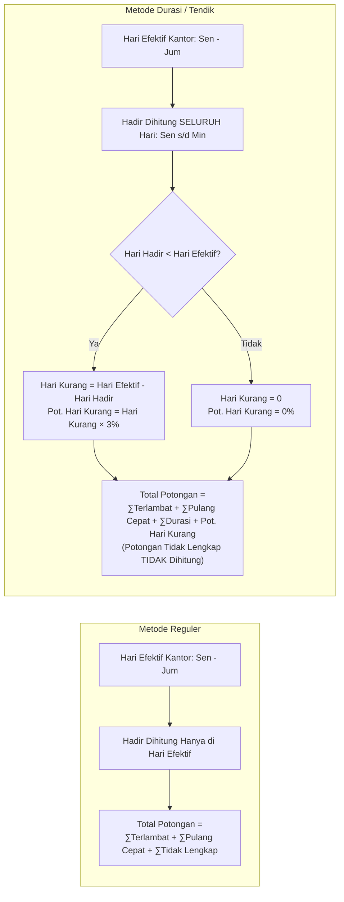
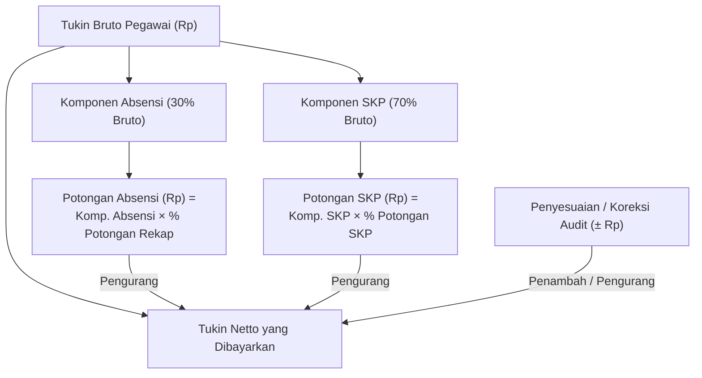

# Panduan Alur Kerja & Aturan Perhitungan Khusus Absensi Tendik (EVKIN Absensi)

Dokumen ini memuat panduan komprehensif mengenai alur kerja (*workflow*) sistem **EVKIN Absensi** serta logika perhitungan khusus bagi **Tenaga Kependidikan (Tendik)**, khususnya yang memiliki karakteristik kerja shift, asrama, atau wali asuh (metode perhitungan **Durasi**).

---

## 1. Konsep Dasar: Mengapa Absensi Tendik Berbeda?

Dalam sistem pengelolaan SDM dan Tunjangan Kinerja (Tukin), pegawai terbagi dalam dua pola kerja utama:

| Aspek | Pegawai Reguler (Staf Kantor) | Tendik / Wali Asuh (Shift / Asrama) |
| :--- | :--- | :--- |
| **Pola Kerja** | Jam kerja kantor tetap (Senin–Kamis 07:30–16:00, Jumat 07:30–16:30) | Pola shift, piket rotasi, asrama, dinas malam |
| **Metode Hitung** | **Metode Reguler** | **Metode Durasi Aktual** |
| **Acuan Harian** | Jam patokan masuk & pulang, toleransi *flexi time* | **Akumulasi durasi jam kerja per hari (standar $\ge$ 7,5 jam)** |
| **Lintas Hari (*Cross-Day*)** | Jarang/tidak berlaku | Berlaku (masuk malam $\ge$ 20:00, pulang esok pagi s/d 14:00) |
| **Hari Libur/Sabtu-Minggu** | Non-aktif (*OFF*), absen di luar jadwal | Kehadiran diakui dan menambah tabungan hari hadir bulanan |
| **Komponen Potongan** | Keterlambatan + Pulang Cepat + Tidak Lengkap (3%) | Potongan Durasi Harian + Potongan Hari Kurang Bulanan |
| **Denda Tidak Lengkap** | Langsung dikenakan denda tidak lengkap (3%) | Diberi status **PERLU_VALIDASI** (dapat diimbangi rekap) |

---

## 2. Flowchart Alur Kerja (Workflow) EVKIN Absensi

Sistem mengimplementasikan prinsip *pipeline* berurutan dengan *gate* verifikasi ketat:

```mermaid
flowchart TD
    classDef startEnd fill:#1e293b,stroke:#0f172a,stroke-width:2px,color:#fff;
    classDef step fill:#f8fafc,stroke:#334155,stroke-width:1.5px,color:#0f172a;
    classDef tendik fill:#e0f2fe,stroke:#0284c7,stroke-width:2px,color:#0369a1;
    classDef verify fill:#fef3c7,stroke:#d97706,stroke-width:2px,color:#92400e;
    classDef calc fill:#ecfdf5,stroke:#059669,stroke-width:2px,color:#065f46;

    Start([Mulai]) :::startEnd --> Step1[1. Pengelolaan Master SDM] :::step
    Step1 --> FlagTendik[Tetapkan Status Tendik: FLAG TENDIK & Jabatan OSDM] :::tendik
    FlagTendik --> Step2[2. Konfigurasi Sistem] :::step
    
    Step2 --> ConfDetail["• Kalender Libur & Hari Efektif<br/>• Jam Masuk/Pulang Standar & Flexi<br/>• Pemetaan Jabatan: Wali Asuh / Tendik → Metode Durasi"] :::step
    
    ConfDetail --> Step3[3. Impor Data Absensi] :::step
    Step3 --> ImportType{"Pilih Jalur Impor"} :::step
    ImportType -->|Excel Standar| Imp1[XLSX e-Absensi / Mesin] :::step
    ImportType -->|Wali Asuh / Shift| Imp2[Import Wali / 18-Hour Pairing] :::tendik
    ImportType -->|CSV Khusus| Imp3[CSV eAbsensi Special] :::tendik
    
    Imp1 & Imp2 & Imp3 --> Step4[4. Hitung Harian / Daily Data] :::calc
    
    subgraph SubHarian [Logika Hitung Harian]
        Step4 --> CekMetode{"Metode Pegawai?"}
        CekMetode -->|Reguler| HarianReg[Evaluasi Jam Masuk, Pulang, Flexi, Tier Terlambat]
        CekMetode -->|Durasi / Tendik| HarianDur[Evaluasi Durasi Aktual Jam Kerja & Lintas Hari]
    end

    SubHarian --> Step5[5. Verifikasi Semi Final] :::verify
    Step5 --> GateCheck{"Ada Duplikasi / Data Anomali?"} :::verify
    GateCheck -->|Ada Error| FixSemi[Koreksi Jam / Rekonsiliasi NIP] :::verify
    FixSemi --> Step5
    GateCheck -->|Lolos Validasi| Step6[6. Hitung Rekap SDM Bulanan] :::calc
    
    subgraph SubRekap [Logika Rekap SDM]
        Step6 --> RekapMetode{"Metode Pegawai?"}
        RekapMetode -->|Reguler| RekapReg["Hadir di Hari Kerja Efektif Saja<br/>Total = Terlambat + Pulang Cepat + Tidak Lengkap"]
        RekapMetode -->|Durasi / Tendik| RekapDur["Hadir Dihitung Senin s/d Minggu<br/>Hari Kurang = Max(0, Hari Efektif - Hari Hadir)<br/>Total = Terlambat + Pulang Cepat + Durasi + Hari Kurang"]
    end
    
    SubRekap --> Step7[7. Final Absensi & Penggabungan Tukin] :::calc
    Step7 --> TukinFormula["Hitung Nominal Rupiah:<br/>• Komponen Absensi: Bruto × 30% × % Potongan<br/>• Komponen SKP: Bruto × 70% × % Potongan<br/>• Penyesuaian / Koreksi Audit (Jika Ada)"] :::calc
    
    TukinFormula --> Step8[8. Ekspor Laporan & Arsip BPK] :::step
    Step8 --> End([Selesai]) :::startEnd
```

---

## 3. Aturan Perhitungan Khusus Absensi Tendik

### 3.1. Identifikasi Pegawai Tendik di Master SDM
1. Pada **Master SDM**, pegawai Tendik ditandai pada profil:
   - Atribut `status_tendik` bernilai `"TENDIK"` (bila tanda `-` berarti SDM PKH biasa).
   - Atribut `jabatan_osdm` mencatat detail tugas (misal: `"Wali Asuh"`, `"Wali Asrama"`, `"Tendik Administrasi"`).
2. Pemetaan Penugasan Bulanan:
   - Menggunakan kolom `FLAG TENDIK [BULAN] [TAHUN]` (misal: `FLAG TENDIK JUNI 2026`).
3. Pemetaan Metode Hitung:
   - Di menu **Konfigurasi $\rightarrow$ Master Jabatan**, jabatan Tendik lapangan (seperti *Wali Asuh*) dipetakan ke metode **`durasi`**, sedangkan tendik administrasi kantor dapat tetap menggunakan metode **`reguler`**.

---

### 3.2. Perhitungan Harian (Tingkat Daily Data)

Pada Tendik dengan metode **Durasi**, sistem tidak membandingkan jam absen terhadap jam buka kantor 07:30, melainkan menghitung total waktu bekerja.

#### A. Ketentuan Durasi & Tier Potongan Harian
Standar jam kerja minimal per hari adalah **7,5 jam (450 menit)**. Jika kurang dari standar, diberlakukan potongan berjenjang:

$$\text{Durasi Kerja} = \text{Jam Pulang} - \text{Jam Masuk}$$

| Durasi Jam Kerja Aktual | Selisih Kekurangan Jam | Persentase Potongan Harian |
| :--- | :--- | :---: |
| $\ge 7,5\text{ jam}$ (450 menit) | Tepat / Lebih (0 menit) | **0% (Tidak ada potongan)** |
| $7,0\text{ jam } \le \text{Durasi} < 7,5\text{ jam}$ | Kurang $\le 30$ menit | **0,5%** |
| $6,5\text{ jam } \le \text{Durasi} < 7,0\text{ jam}$ | Kurang $31 - 60$ menit | **1,0%** |
| $6,0\text{ jam } \le \text{Durasi} < 6,5\text{ jam}$ | Kurang $61 - 90$ menit | **1,5%** |
| $5,5\text{ jam } \le \text{Durasi} < 6,0\text{ jam}$ | Kurang $91 - 120$ menit | **2,0%** |
| $< 5,5\text{ jam}$ (< 330 menit) | Kurang $> 120$ menit | **3,0%** |

#### B. Dinas Malam & Lintas Hari (*Cross-Day*)
Bagi Wali Asuh yang berdinas malam (contoh: masuk pukul 20:00 malam dan selesai dinas pukul 07:00 pagi keesokan harinya):
- Sistem mengenali *flag* `crossDay` dengan menambahkan offset 24 jam (+1440 menit) pada jam pulang.
- Durasi dihitung: `(07:00 + 24 jam) - 20:00 = 11 jam`.
- Karena $11\text{ jam} \ge 7,5\text{ jam}$ dan rekaman lengkap, status dinyatakan `LINTAS_HARI` dengan **potongan harian 0%**.

#### C. Penanganan Absen Tidak Lengkap
- Pada pegawai biasa, lupa absen masuk atau lupa absen pulang langsung didenda **3%**.
- Pada jabatan Wali Asuh/Tendik durasi: Sistem menandai sebagai `PERLU_VALIDASI` dengan keterangan `REKAMAN SHIFT TIDAK LENGKAP - CEK REKAP HARI KERJA`. Denda 3% harian tidak dijatuhkan langsung agar operator dapat memvalidasi log shift sebelum rekap bulanan.

#### D. Kehadiran di Hari Libur / Akhir Pekan
- Tendik yang piket pada hari Sabtu, Minggu, atau tanggal merah tidak dikenai penalti keterlambatan reguler.
- Rekaman kehadiran tersebut tetap dicatat dan diakui sebagai **kehadiran aktif** untuk diperhitungkan pada rekapitulasi bulanan.

---

### 3.3. Perhitungan Rekapitulasi Bulanan (Tingkat Rekap SDM)

Ini adalah perbedaan paling signifikan antara pegawai Reguler dan Tendik Durasi:



#### Rumus Rekap Tendik Durasi:
1. **Perhitungan Hari Hadir**:
   $$\text{hariAdaAbsensi} = \text{Total tanggal unik kehadiran (Senin s/d Minggu) + Cuti Sah}$$
   *(Piket hari Sabtu dan Minggu otomatis menambah jumlah hari hadir!)*

2. **Perhitungan Hari Kurang**:
   $$\text{hariKurang} = \max(0, \text{hariEfektif} - \text{hariAdaAbsensi})$$
   $$\text{potHariKurang} = \text{hariKurang} \times \text{Tarif Potongan Hari Kurang (default 3\%)}$$

3. **Total Potongan Bulanan Tendik**:
   $$\text{Total Raw} = \sum \text{Potongan Keterlambatan} + \sum \text{Potongan Pulang Cepat} + \sum \text{Potongan Durasi} + \text{Potongan Hari Kurang}$$
   $$\text{Total Potongan Akhir} = \min(100\%, \text{Total Raw})$$

> [!IMPORTANT]
> **Mengapa Potongan Tidak Lengkap (3%) dihilangkan pada rekap Tendik?**  
> Agar tidak terjadi **hukuman ganda (*double penalty*)**. Kekurangan kehadiran Tendik shift sudah dievaluasi secara adil melalui mekanisme **Hari Kurang** terhadap target **Hari Efektif**.

---

### 3.4. Integrasi dengan Tunjangan Kinerja (Final Tukin)

Komposisi Tukin mengacu pada aturan resmi:
- **30% Komponen Kehadiran (Absensi)**
- **70% Komponen Kinerja (SKP)**



#### Rumus Nominal:
1. $\text{Komponen Absensi (Rp)} = \text{Tukin Bruto} \times 30\%$
2. $\text{Potongan Absensi (Rp)} = \text{Komponen Absensi} \times \frac{\text{Total Persentase Potongan Rekap}}{100}$
3. $\text{Komponen SKP (Rp)} = \text{Tukin Bruto} \times 70\%$
4. $\text{Potongan SKP (Rp)} = \text{Komponen SKP} \times \frac{\text{Persentase Potongan SKP}}{100}$
5. $\text{Total Potongan (Rp)} = \text{Potongan Absensi} + \text{Potongan SKP}$
6. $\text{Final Tukin Dibayarkan (Rp)} = \text{Tukin Bruto} - \text{Total Potongan} + \text{Penyesuaian}$

---

## 4. Simulasi Contoh Kasus Riil

### Kasus: Tendik "Ahmad" (Wali Asuh Asrama)
- **Tukin Bruto**: Rp 5.000.000,-
- **Bulan**: Agustus 2026 (Hari Efektif Kantor = 21 hari).
- **Catatan Kerja**:
  - Bertugas shift selama 19 hari kerja biasa (Senin–Jumat) dengan durasi penuh $\ge 7,5$ jam.
  - Bertugas piket asrama selama 2 hari di akhir pekan (Sabtu & Minggu) durasi $\ge 7,5$ jam.
  - Memiliki 1 hari dinas dengan durasi hanya 6,8 jam (kurang 42 menit $\rightarrow$ tier potongan 1,0%).
  - SKP predikat "Baik" (Potongan SKP 0%).

### Langkah Perhitungan:
1. **Hitung Harian**:
   - 20 hari shift penuh $\rightarrow$ Potongan durasi = 0%.
   - 1 hari shift 6,8 jam $\rightarrow$ Potongan durasi = 1,0%.
   - Total potongan durasi harian $\sum \text{Durasi} = 1,0\%$.
2. **Hitung Rekap Bulanan**:
   - Hari Efektif Kantor = 21 hari.
   - Hari Ada Absensi = 19 (hari kerja) + 2 (akhir pekan) = **21 hari**.
   - Hari Kurang = $\max(0, 21 - 21) = \mathbf{0\text{ hari}}$.
   - Potongan Hari Kurang = $0 \times 3\% = \mathbf{0\%}$.
   - **Total Potongan Absensi Bulanan** = $1,0\% + 0\% = \mathbf{1,0\%}$.
3. **Hitung Final Tukin**:
   - Komponen Absensi (30%) = Rp 5.000.000 $\times$ 30% = Rp 1.500.000,-
   - Potongan Absensi (Rp) = Rp 1.500.000 $\times$ 1,0% = **Rp 15.000,-**
   - Komponen SKP (70%) = Rp 5.000.000 $\times$ 70% = Rp 3.500.000,-
   - Potongan SKP (Rp) = Rp 3.500.000 $\times$ 0% = **Rp 0,-**
   - **Total Potongan** = Rp 15.000,-
   - **Final Tukin Diterima** = Rp 5.000.000 - Rp 15.000 = **Rp 4.985.000,-**

*(Jika Ahmad dihitung dengan metode reguler lama secara keliru, 2 hari piket akhir pekan tidak diakui dan ia akan didenda Hari Kurang 2 hari $\times$ 3% = 6% potongan tambahan! Dengan metode Durasi Tendik, hak kehadiran di akhir pekan terlindungi secara adil).*

---

## 5. Ringkasan Tindakan Operator (SOP Cepat)

1. **Pastikan Master SDM Terupdate**:
   Periksa kolom `Status Tendik` dan `Jabatan OSDM` di menu Master SDM.
2. **Cek Konfigurasi Jabatan**:
   Pastikan di tab **Konfigurasi $\rightarrow$ Master Jabatan**, jabatan *Wali Asuh* / *Wali Asrama* memiliki pilihan metode **`durasi`**.
3. **Pilih Mode Impor yang Tepat**:
   - Bila file berisi tap shift / jam ganjil malam: Gunakan jalur impor **Import Wali** atau **Import CSV eAbsensi**.
4. **Verifikasi Semi Final**:
   Bila muncul peringatan `REKAMAN SHIFT TIDAK LENGKAP`, cek apakah pegawai bertugas shift malam yang tap pulangnya tercatat di baris tanggal berikutnya.
5. **Hitung Rekap & Periksa Kolom**:
   Perhatikan kolom `Hari Kurang` dan `Pot. Durasi` pada tabel Rekap SDM.
6. **Final & Ekspor**:
   Jalankan Final Absensi atau Gabungan SKP, lakukan penyesuaian nominal bila ada surat tugas luar biasa, kemudian unduh laporan Excel via tombol **Smart Export** atau **Excel Dasar Tukin**.
